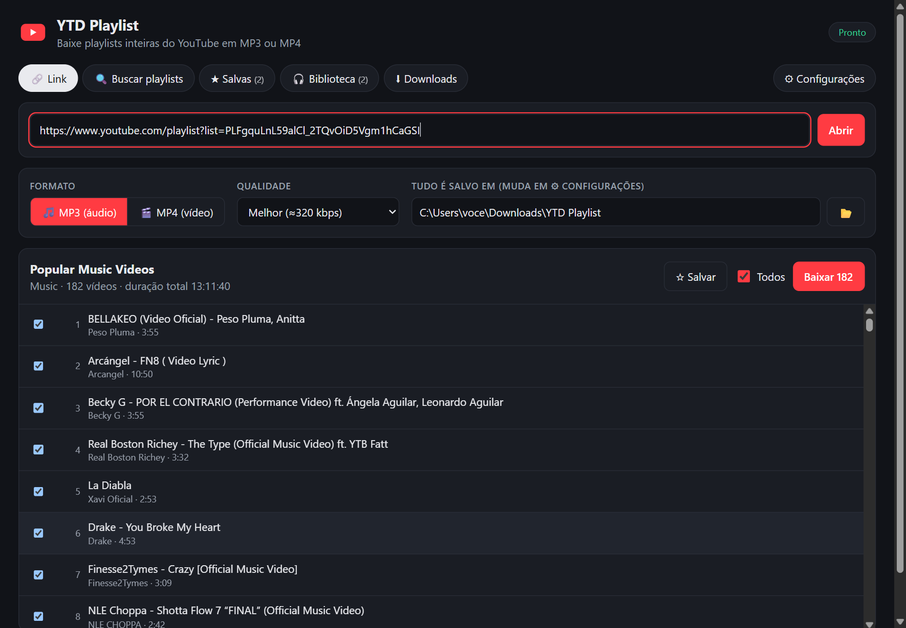
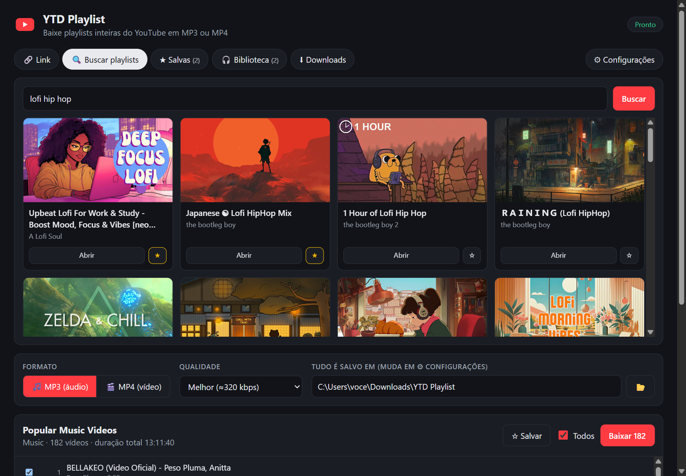
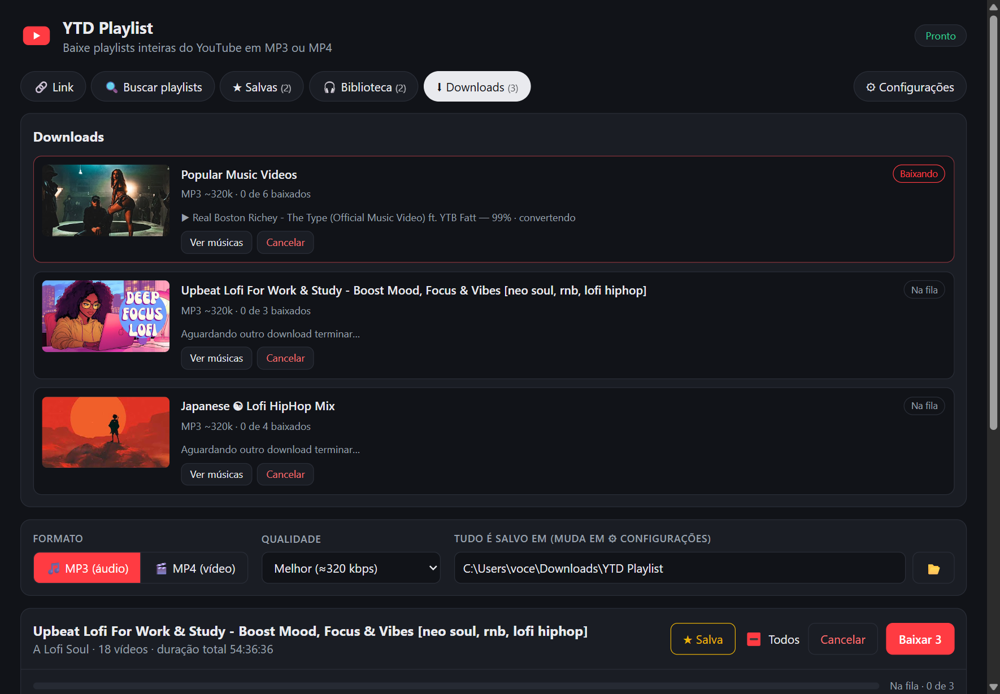
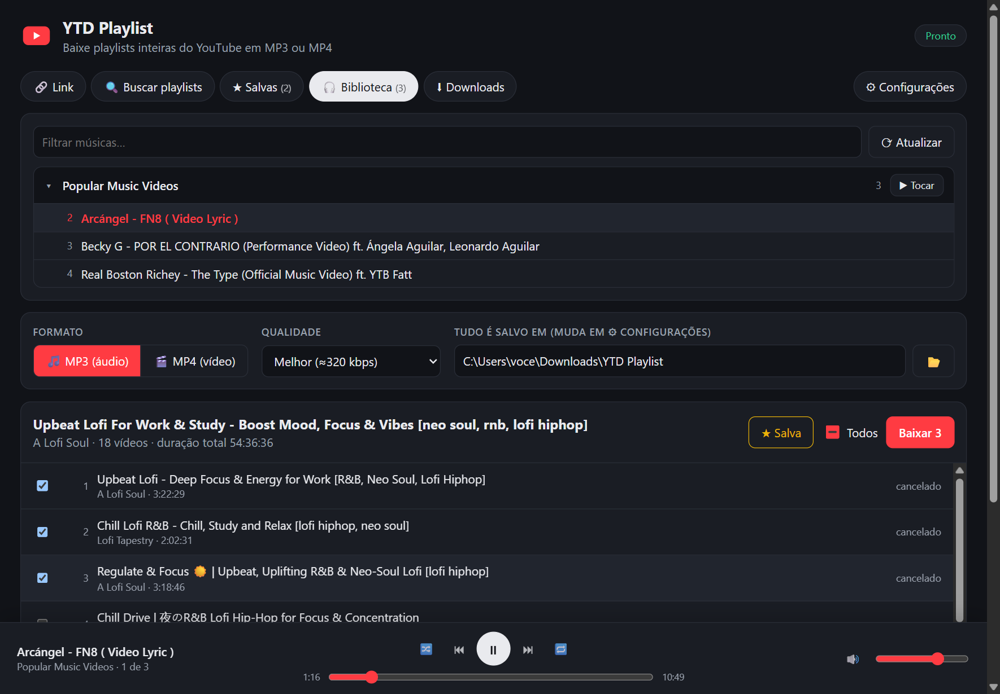
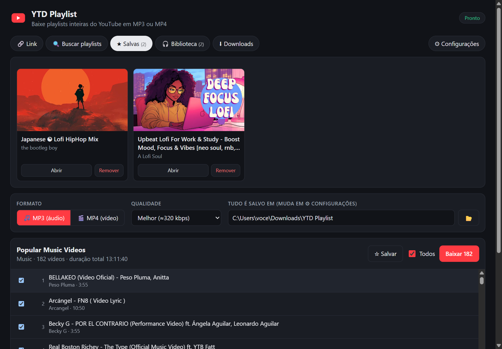
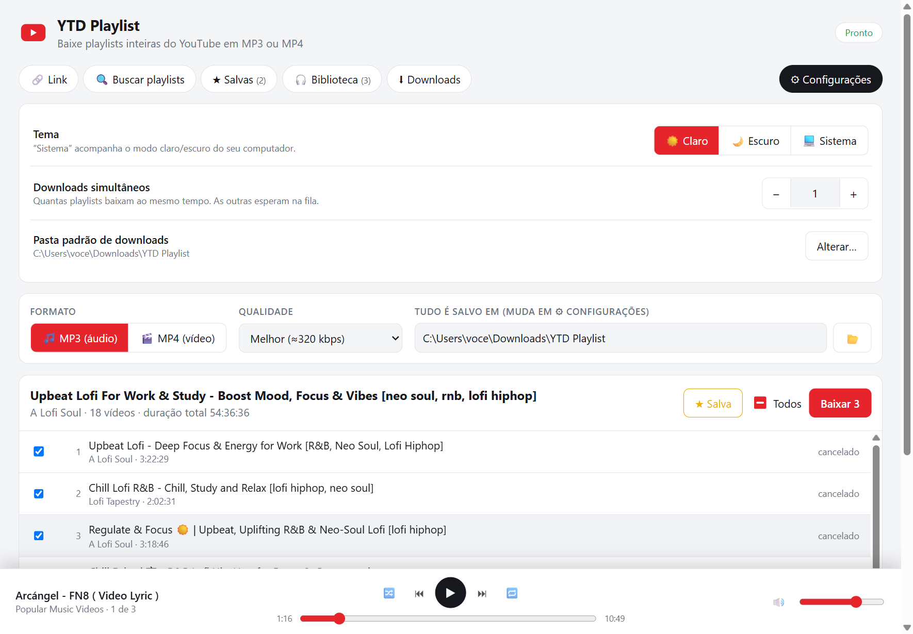

<div align="center">

# 🎵 YTD Playlist

**Baixe playlists inteiras do YouTube em MP3 ou MP4, com busca, fila de downloads e player integrado.**

Para Windows, macOS e Linux.

[](https://github.com/kaua-alves-queiros/YTD-Playlist/releases/latest)
[](https://github.com/kaua-alves-queiros/YTD-Playlist/actions/workflows/build.yml)
[](https://github.com/kaua-alves-queiros/YTD-Playlist/releases)

[](LICENSE)

[**⬇ Baixar a última versão**](https://github.com/kaua-alves-queiros/YTD-Playlist/releases/latest)

<br>



</div>

---

## ✨ Funcionalidades

| | |
|---|---|
| 🔗 **Cole o link e pronto** | Abra qualquer playlist (ou vídeo) do YouTube e veja todas as músicas com duração e canal. |
| ✅ **Escolha o que baixar** | Marque só as faixas que quiser ou baixe a playlist inteira de uma vez. |
| 🎵 **MP3 ou 🎬 MP4** | MP3 até ~320 kbps com capa e metadados, ou vídeo MP4 de 360p até 4K. |
| 🔍 **Buscador de playlists** | Pesquise direto no app ("rock anos 80", "lofi para estudar"…) e abra com um clique. |
| ★ **Playlists salvas** | Guarde suas favoritas. Para atualizar, é só baixar de novo: só as músicas novas são baixadas. |
| ⬇ **Fila de downloads** | Mande várias playlists de uma vez e acompanhe tudo numa página própria. Você escolhe quantas baixam ao mesmo tempo. |
| 🎧 **Biblioteca + player** | Ouça o que já baixou sem sair do app: aleatório, repetir, barra de tempo, volume e teclas de mídia do teclado. |
| 🌗 **Tema claro / escuro / sistema** | Segue o modo do seu computador ou fica fixo do jeito que você preferir. |
| ♻️ **Continua de onde parou** | Se fechar no meio, é só baixar de novo: o que já terminou é pulado. |
| 🔄 **Sempre atualizado** | O motor de download ([yt-dlp](https://github.com/yt-dlp/yt-dlp)) se atualiza sozinho toda vez que o app abre. |

## 📸 Capturas de tela

<table>
  <tr>
    <td width="50%"><p align="center"><b>Buscador de playlists</b></p></td>
    <td width="50%"><p align="center"><b>Fila de downloads</b></p></td>
  </tr>
  <tr>
    <td width="50%"><p align="center"><b>Biblioteca e player</b></p></td>
    <td width="50%"><p align="center"><b>Playlists salvas</b></p></td>
  </tr>
  <tr>
    <td colspan="2"><p align="center"><b>Configurações (tema claro)</b></p></td>
  </tr>
</table>

## ⬇ Instalação

Baixe o arquivo do seu sistema na [página de Releases](https://github.com/kaua-alves-queiros/YTD-Playlist/releases/latest):

| Sistema | Arquivo |
|---|---|
| 🪟 **Windows** — instalador | `YTD-Playlist-Setup-x.y.z-windows-x64.exe` |
| 🪟 **Windows** — portátil (não instala nada) | `YTD-Playlist-Portable-x.y.z-windows-x64.exe` |
| 🍎 **macOS** — Apple Silicon (M1, M2, M3, M4) | `YTD-Playlist-x.y.z-mac-arm64.dmg` |
| 🍎 **macOS** — Intel | `YTD-Playlist-x.y.z-mac-x64.dmg` |
| 🐧 **Linux** — qualquer distro | `YTD-Playlist-x.y.z-linux-x86_64.AppImage` (ou `arm64`) |
| 🐧 **Linux** — Debian / Ubuntu | `YTD-Playlist-x.y.z-linux-amd64.deb` (ou `arm64`) |

> [!NOTE]
> O app não tem certificado de assinatura pago, então o sistema pode reclamar na primeira vez:
> - **Windows:** em *"O Windows protegeu o computador"*, clique em **Mais informações → Executar assim mesmo**.
> - **macOS:** se aparecer que o app *"está danificado"* ou *"não pode ser aberto"*, rode no Terminal:
>   ```bash
>   xattr -cr "/Applications/YTD Playlist.app"
>   ```
> - **Linux (AppImage):** dê permissão de execução com `chmod +x YTD-Playlist-*.AppImage` e abra.

Não precisa instalar Python, ffmpeg nem nada além do app. Na primeira abertura ele baixa o componente yt-dlp (~25 MB) sozinho.

## 🚀 Como usar

1. **Cole o link** da playlist na aba **🔗 Link**, ou procure uma em **🔍 Buscar playlists**.
2. Escolha **MP3** ou **MP4** e a **qualidade**.
3. Desmarque o que não quiser e clique em **Baixar**. A playlist vai para a aba **⬇ Downloads**.
4. Quando terminar, ouça tudo na aba **🎧 Biblioteca**.

Tudo é salvo numa pasta só, por padrão `Downloads/YTD Playlist`, com uma subpasta por playlist e as músicas numeradas na ordem original:

```
Downloads/
└── YTD Playlist/
    ├── Rock Anos 80/
    │   ├── 001 - Nome da música.mp3
    │   ├── 002 - Outra música.mp3
    │   └── …
    └── Lofi para Estudar/
        └── …
```

A pasta pode ser trocada em **⚙ Configurações**.

## ❓ Perguntas frequentes

<details>
<summary><b>Fechei o app no meio do download. Perdi tudo?</b></summary>

Não. Abra a mesma playlist e clique em **Baixar** de novo. As músicas que já terminaram são reconhecidas e puladas, e o resto continua.
</details>

<details>
<summary><b>Como atualizo uma playlist que ganhou músicas novas?</b></summary>

Salve a playlist com **☆ Salvar** e, quando quiser atualizar, abra em **★ Salvas** e clique em **Baixar**. Só as músicas novas são baixadas.
</details>

<details>
<summary><b>Algumas músicas aparecem riscadas ou "indisponível"</b></summary>

São vídeos privados, removidos ou bloqueados na sua região. O YouTube não deixa baixar esses vídeos, então eles são ignorados.
</details>

<details>
<summary><b>Quantos downloads simultâneos devo usar?</b></summary>

O padrão é 2. Dá pra aumentar em **⚙ Configurações**, mas com muitos ao mesmo tempo (mais de 5 ou 6) o YouTube pode limitar a velocidade ou bloquear temporariamente. Se começarem a aparecer erros, diminua.
</details>

<details>
<summary><b>Parou de funcionar de repente</b></summary>

O YouTube muda com frequência. O app atualiza o yt-dlp sempre que abre, então feche e abra de novo, com internet. Se continuar, abra uma [issue](https://github.com/kaua-alves-queiros/YTD-Playlist/issues).
</details>

## 🛠 Desenvolvimento

Requisitos: [Node.js](https://nodejs.org) 20 ou mais recente.

```bash
git clone https://github.com/kaua-alves-queiros/YTD-Playlist.git
cd YTD-Playlist
npm install
npm start
```

### Gerar instaladores localmente

```bash
npm run dist:win     # Windows: instalador + portátil
npm run dist:mac     # macOS: .dmg (precisa rodar num Mac)
npm run dist:linux   # Linux: .AppImage + .deb
```

Os arquivos ficam em `dist/`.

### Estrutura

```
src/
├── main.js          # processo principal: janela, fila de downloads, busca, biblioteca, configurações
├── ytdlp.js         # baixa/atualiza o yt-dlp e monta os comandos de download
├── preload.cjs      # ponte segura entre a interface e o processo principal
└── renderer/        # interface (HTML/CSS/JS puro, sem framework)
    ├── index.html
    ├── renderer.js
    └── style.css
```

### Publicar uma versão

O workflow [`build.yml`](.github/workflows/build.yml) compila em 5 máquinas (Windows x64, macOS Apple Silicon, macOS Intel, Linux x64 e Linux ARM64) e cria o Release com os instaladores anexados:

```bash
git tag v1.0.0
git push origin v1.0.0
```

- A versão do app vem da tag.
- Tags com hífen, como `v1.1.0-beta.1`, saem como pré-release.
- Push na `main` e Pull Requests só compilam, para conferir se nada quebrou.

## 🧰 Feito com

- [Electron](https://www.electronjs.org): app desktop multiplataforma
- [yt-dlp](https://github.com/yt-dlp/yt-dlp): download e leitura das playlists
- [FFmpeg](https://ffmpeg.org), via [ffmpeg-static](https://github.com/eugeneware/ffmpeg-static): conversão para MP3 e junção de áudio e vídeo
- [electron-builder](https://www.electron.build): instaladores e GitHub Actions para os builds

## ⚖️ Aviso

Use o YTD Playlist apenas para baixar conteúdo que você tem direito de baixar: vídeos seus, conteúdo em domínio público ou com licença que permita. Respeite os [Termos de Serviço do YouTube](https://www.youtube.com/t/terms) e os direitos autorais dos criadores. Este projeto não tem relação com o YouTube nem com o Google.

## 📄 Licença

[MIT](LICENSE) © kaua-alves-queiros
